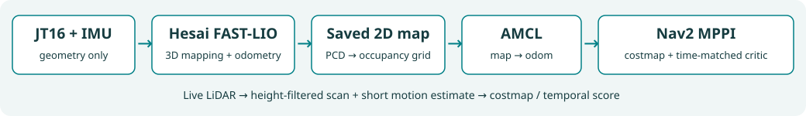
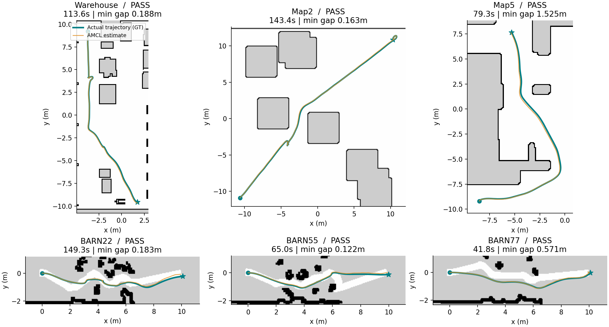
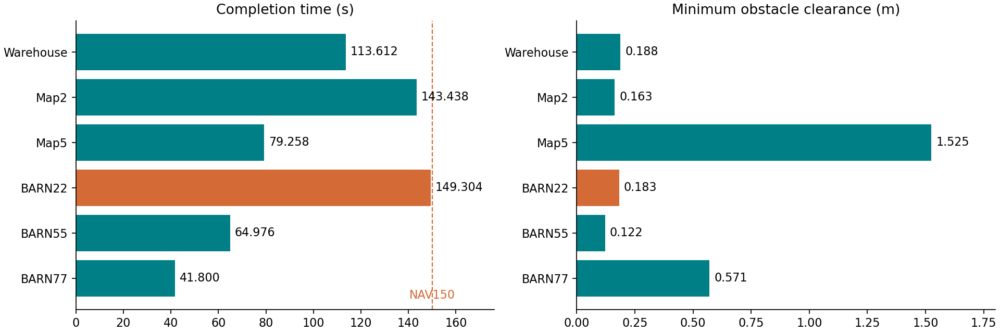
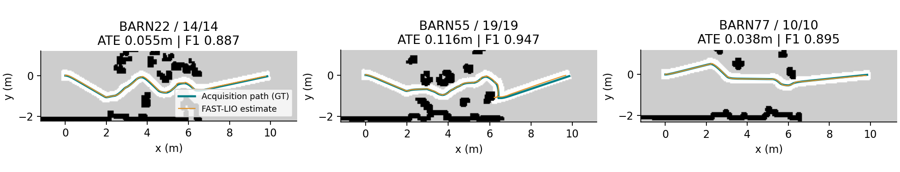

# V0 技术报告

2026-11-01 · 代码 `adcc6a9` · 标签 `v0` · **小规模仿真基线完成**

**导航 6/6 · 碰撞 0 · 新建图 3/3 · 测试 54 + 5 · 独立评审六维 PASS**

## 方案

官方 Hesai FAST-LIO 做三维建图和里程计，保存二维栅格后，AMCL + Nav2 导航。障碍处理只使用 LiDAR 几何信息。

| 实现 | V0 配置 |
|---|---|
| 底座 | ROS 2 Jazzy / Gazebo Harmonic；官方 Hesai FAST-LIO 固定 commit |
| 仿真 LiDAR | 水平安装 0°；高度 0.36m；暂用 16 通道、−40°～0°均匀模型 |
| 二维输入 | FAST-LIO 去畸变点云；高度过滤 0.02～0.35m；300 个角度分箱 |
| 定位 | FAST-LIO bridge 唯一发布 `odom → base_link`；AMCL 发布 `map → odom` |
| 控制 | MPPI 15Hz，2,000 条候选 × 56 步；线速上限 0.35m/s、角速上限 0.6rad/s |
| 动态障碍 | LiDAR 聚类测速；最多延续 0.5s；按每个候选姿态的未来时刻评分；保留真实 costmap 和 Collision Monitor |

## 导航：同版六例，严格成功

通过条件：动作 `SUCCEEDED`、零碰撞、输入/定位/评分有效，导航期限 150s。六例重评分与原始 JSON 一致，九次采集共享 **76 项源码 / 33 项运行库哈希**。

青色：实际轨迹；橙色：AMCL 估计。底图为该例实际使用的地图。GT 只用于离线评估，不参与导航控制。

| 场景 / seed | 用时 s | 最小障碍间隙 m | 目标误差 m |
|---|---:|---:|---:|
| Arena warehouse / 1 | 113.612 | 0.188 | 0.016 |
| Arena map2 / 0 | 143.438 | 0.163 | 0.091 |
| Arena map5 / 1 | 79.258 | 1.525 | 0.059 |
| BARN22 / 0 | 149.304 | 0.183 | 0.242 |
| BARN55 / 0 | 64.976 | 0.122 | 0.124 |
| BARN77 / 0 | 41.800 | 0.571 | 0.092 |

Arena 每例 5 个动态障碍；BARN 为静态密集障碍。间隙定义是评估几何体之间的距离，不是 LiDAR 测距。

耗时与间隙图：BARN22 是当前薄弱点

## 建图：三例重新采集，不复用历史地图

灰/黑：FAST-LIO 导出的二维地图；青色：规定采集路径的实际轨迹；橙色：FAST-LIO 估计。采集沿规定路径由 GT 驱动，**不是自主探索**；后续导航独立运行。

| 场景 | 完成路径点 | ATE RMSE m | 占用栅格 F1 | IoU |
|---|---:|---:|---:|---:|
| BARN22 | 14/14 | 0.055 | 0.887 | 0.796 |
| BARN55 | 19/19 | 0.116 | 0.947 | 0.899 |
| BARN77 | 10/10 | 0.038 | 0.895 | 0.810 |

ATE：对齐初始坐标后的轨迹误差；F1 / IoU：对齐后占用栅格与场景几何的匹配质量。

## 视频：Arena 动态障碍遥测回放

<video controls preload="metadata" poster="assets/replay-poster.png" style="width:100%;border-radius:12px" aria-label="Arena 三场景遥测回放，8倍速，不是相机录像"><source src="assets/arena-replay.mp4" type="video/mp4"></video>

[打开视频](assets/arena-replay.mp4) · 8 倍速遥测回放，非相机录像。青色矩形为机器人 footprint，橙色圆为独立观测的障碍位置；各场景到终点后停帧。

## 修复与边界

修复了 TF/里程计输入、倾斜投影与高度过滤、时序输入检查、短时运动记忆，以及“建图超时仍返回成功”和不完整地图续跑。时间评分改为最小平方距离后一次开方，原公式等价测试通过。

最早失败版 warehouse 碰撞；距离计算修复后单例复验及当前小集均零碰撞。不是所有指标都改善：BARN55 的建图 ATE 比历史候选大。

**下一步：**BARN22 仅余 **0.696s** 超时裕量；此前同源码 map2 出现一次 DDS 生命周期应答超时。优先提高这两处可靠性。遮挡/转弯预测有限，旋转 shim / 恢复动作不走时间评分。真实 JT16 外参、通道校正、噪声和轮动态，以及全量成功率仍待验证。

## 复核入口

[指标与来源哈希](evidence.json) · [独立 delivery 评审](../reviews/20261101-current-gate-rereview.md) · [Ponytail 评审](../reviews/20261101-current-gate-ponytail-review.md) · [版本范围](release.md)

本机原始证据：`integration/results/v0/timed-mppi-startup-pilot/`。仓库只提交精简报告/图表/回放，原始 NPZ/PCD 留在本机。

重生成：`/usr/bin/python3 docs/v0/render_report.py`；需要本机原始结果、Matplotlib、Pillow、PyYAML、Python Markdown、FFmpeg。
